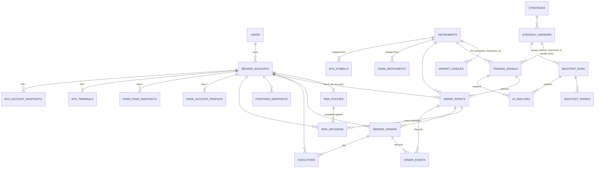

# 10 — Trading Phase A: common trading foundation

**Status:** done (revision `0006`). Everything is **read-only and broker-agnostic**. No broker
is called in production yet: the adapter registry is empty until Phase B (Dhan) and
Phase C (MT5), so broker reads return `501 not_supported`. Every account defaults to
**OBSERVE**, and **LIVE cannot be selected**.

## Ground rules

- **Decimals everywhere.**
  - DB: price, quantity and money columns are `NUMERIC` (price 24,8; quantity 24,6; money 20,4).
  - Python: `Decimal`. The trading DTOs raise `TypeError` if given a `float`.
  - JSON: Decimals are serialized as **strings** (`"2890.05"`). Clients should send strings too.
- **UTC, with a session tag.** Timestamps are `timestamptz`. Candles, signals, executions and
  backtest trades carry `session`, which uses the same values as the Spasta `trades` table.
  `session_for(ts)` maps a timestamp to exactly one tag:

  | Session | UTC range | IST |
  | --- | --- | --- |
  | London | 07:00–13:00 | 12:30–18:30 |
  | NY | 13:00–22:00 | 18:30–03:30 |
  | Asia | 22:00–07:00 | 03:30–12:30 |

- **Namespaced broker identifiers.** Every broker ID (order ID, trade ID, client ID) is stored
  next to a `broker_account_id`, which points at `trading.broker_accounts`, unique on
  (`broker`, `account_id`). Two brokers or accounts can therefore never collide.
- **Credentials are never stored in the DB.** Dhan tokens and MT5 passwords live in env
  only (Phases B and C).
- **AI can't place orders.** `order_intents.source` accepts only `manual` or `strategy`; an
  AI agent is not a valid source. `ai_analyses` stores explanations only.

## Execution modes

`trading.broker_accounts.mode` (CHECK `OBSERVE|PAPER|LIVE`, default `OBSERVE`).

| Change | Who | Result |
| --- | --- | --- |
| OBSERVE ↔ PAPER, any → OBSERVE/PAPER | admin + CSRF | 200, audited `trading_mode_changed` (from → to) |
| → LIVE with `TRADING_LIVE_ENABLED=false` (default) | admin | 403 `live_disabled`, audited `trading_mode_change_denied` |
| → LIVE with the flag on, no or invalid token | admin | 403 `confirmation_required` |
| → LIVE with the flag on and a valid token | admin | **409 `preconditions_unmet`**, listing the Phase G work still missing |

`POST /accounts/{id}/mode/live-token` issues a single-use confirmation token. It's an admin
call that only works with the flag on. The token is stored hashed in Redis for
`TRADING_LIVE_TOKEN_TTL_SECONDS` (300 s) and is bound to both the account and the admin who
asked for it. LIVE stays unreachable even with the flag and a token: Phase G has to add
the static-IP preflight, an account risk policy with a tested kill switch, fresh-credential
checks, and the separate execution module.

## Interfaces (`app/agents/trading/`)

| File | Contents |
| --- | --- |
| `types.py` | Enums: `Broker`, `ExecutionMode`, `Side`, `SignalSide`, `OrderType`, `OrderStatus`, `Timeframe` (`1m 5m 15m 30m 1h 4h 1d`) and `Session`. DTOs (frozen, Decimal-checked): `AdapterHealth`, `AccountInfo`, `Funds`, `Position`, `BrokerOrder`, `InstrumentInfo`, `Quote`, `Candle`, `Tick`. Also `session_for()`. |
| `base.py` | `BrokerAdapter` (ABC) and the exceptions `NotSupported`, `BrokerError` and `CredentialsExpired` |
| `fake.py` | `FakeBrokerAdapter` (deterministic, supports everything) and `NullAdapter` (supports only `health`). Tests only; never registered in production. |

```python
class BrokerAdapter(ABC):
    broker: ClassVar[str]
    async def health(self) -> AdapterHealth                       # abstract; never raises for a down broker
    async def accounts(self) -> list[AccountInfo]
    async def funds(self, account_id: str) -> Funds
    async def positions(self, account_id: str) -> list[Position]  # signed qty: >0 long, <0 short
    async def orders(self, account_id: str) -> list[BrokerOrder]  # normalized + raw status
    async def instruments(self) -> list[InstrumentInfo]
    async def quotes(self, symbols: Sequence[str]) -> list[Quote] # only the requested symbols
    async def candles(self, symbol, tf: Timeframe, start, end) -> list[Candle]  # start <= ts < end, ascending
    def subscribe_ticks(self, symbols) -> AsyncIterator[Tick]     # implement as an async generator
```

Every method except `health` raises `NotSupported` in the base class, so an adapter
implements only what its broker really offers and **never fakes data**. The interface has no
order placement, modification or cancellation; that lives in a separate module behind the
LIVE gate in Phase G.

### Adapter contract

`tests/trading_contract.py::check_adapter(adapter, account_id, symbol)` is the shared contract
that Phases B and C run against recorded fixtures. Each method must return correctly typed
DTOs or raise `NotSupported`. It also checks:

- no floats anywhere
- every timestamp in UTC
- quotes only for the requested symbols
- candles ascending and inside `[start, end)`, with `low ≤ open/close ≤ high`
- ticks typed with Decimal prices

## Endpoints (`/api/trading`, all require a session)

| Method | Path | Notes |
| --- | --- | --- |
| GET | `/accounts?limit&offset` | Owners see their own accounts; admins see all |
| POST | `/accounts` | **admin + CSRF, audited**: `{broker: dhan\|mt5, account_id, label, base_currency, owner_user_id?}`. Mode is always OBSERVE. 409 if it already exists. |
| GET | `/accounts/{id}` | 404 if the account isn't yours |
| POST | `/accounts/{id}/mode` · `/mode/live-token` | **admin + CSRF, audited**: see Execution modes above |
| GET · PUT | `/accounts/{id}/risk-policy` | PUT is **admin + CSRF, audited** with before → after |
| GET | `/accounts/{id}/health` | 200 `{supported, ok, detail, credentials_expire_at}` |
| GET | `/accounts/{id}/funds` · `/positions` · `/orders` | From the adapter, every value labelled `source: "broker"`. 501 / 502 / 504, see below. |
| GET | `/quotes?broker=&symbols=A,B` | 1–50 symbols |
| GET | `/instruments?broker&q&instrument_type` | From `trading.instruments` |
| GET | `/candles?instrument_id&timeframe&start&end&limit` | `start`/`end` must carry a timezone. Returns the latest `limit` candles in range, oldest first. |
| GET | `/strategies` | Each strategy with its versions, newest first |
| GET | `/signals?strategy_version_id&instrument_id&side&since` | |
| GET | `/executions?account_id&since&until` | Only your accounts' executions; each has `source` `broker` or `simulated` |
| GET | `/agents` · `/agents/{id}/status` · `/agents/{id}/logs` | Registry agents of kind `trading`; logs are admin-only |

Errors from broker reads:

| Status | `detail.code` | When |
| --- | --- | --- |
| 501 | `not_supported` | No adapter for that broker, or the adapter raised `NotSupported`. The body includes `broker`, `operation` and `detail`. |
| 502 | `broker_error` | The broker call failed (message safe to show) |
| 504 | `broker_timeout` | The call took longer than `TRADING_ADAPTER_TIMEOUT` (10 s) |

## Data model (migration `0006`)

Additive only: three new schemas (`trading`, `dhan`, `mt5`) and 22 new tables. `public.trades`
and the other Spasta tables are untouched. The downgrade to `0005` drops exactly these tables
and then the schemas, without CASCADE.



| Table | Purpose · key constraints |
| --- | --- |
| `trading.broker_accounts` | Account per (`broker`, `account_id`) unique; `broker` ∈ dhan, mt5; `mode` ∈ OBSERVE, PAPER, LIVE (default OBSERVE); owner; who changed the mode and when |
| `trading.instruments` | Normalized instruments, unique (`broker`, `broker_instrument_id`); lot and tick size; expiry, strike and option type for F&O |
| `trading.strategies` / `strategy_versions` | Versioned strategy parameters (`code_ref`, `params`), unique (`strategy`, `version`) |
| `trading.market_candles` | PK (`instrument`, `timeframe`, `ts`); CHECK on timeframe, session and high ≥ low; `source`, `is_gap` |
| `trading.trading_signals` | BUY, SELL or NO_TRADE plus recorded `inputs`; dedupe on (`version`, `instrument`, `tf`, `candle_time`) |
| `trading.risk_policies` | One per account: `max_daily_loss`, `max_exposure`, `max_position_size`, `max_drawdown_pct`, `allowed_sessions[]`, `kill_switch`; CHECKs that limits are non-negative and drawdown is 0–100 |
| `trading.risk_decisions` | Every evaluation: `approved`, `reason`, the policy snapshot, `inputs`, and each check's result |
| `trading.order_intents` | Requested orders: quantity > 0; `mode` at creation; `source` ∈ manual, strategy; status lifecycle; unique `correlation_id` |
| `trading.broker_orders` | Orders as the broker reports them; unique (`account`, `broker_order_id`); raw and normalized status; `raw` JSONB |
| `trading.order_events` | Append-only lifecycle for an intent and/or a broker order, with `correlation_id` |
| `trading.executions` | Fills: unique (`account`, `broker_trade_id`) when present; `is_simulated` for PAPER; fees |
| `trading.positions_snapshots` | Signed quantity; `source` ∈ broker, simulated, calculated |
| `trading.backtest_runs` / `backtest_trades` | Run parameters, costs, metrics and status; each simulated trade with its session |
| `trading.ai_analyses` | An explanation of exactly one signal or one backtest (CHECK) |
| `dhan.instruments` | Dhan instrument master, PK (`exchange_segment`, `security_id`), with `raw` and a link to `trading.instruments` (filled in Phase B) |
| `dhan.account_profiles` · `dhan.fund_snapshots` | Client ID, token expiry, segments, funds history; **no token stored** |
| `mt5.terminals` · `mt5.symbols` · `mt5.account_snapshots` | Terminal and login, symbol specs per server, balance and equity history (filled in Phase C) |

## Tests

- `tests/test_trading_core.py` (no DB):
  - the session partition and UTC handling
  - floats and naive datetimes rejected
  - Decimal precision kept exactly
  - `NotSupported` as the default for every method
  - the contract suite against the fake and null adapters
- `tests/test_trading_schema.py`:
  - every one of the 22 tables round-trips, including `0.00000001` and `9999999999999999.12345678`, arrays, JSONB and signed quantities
  - CHECK and unique constraints: broker, mode, timeframe, session, high/low, quantity, source, non-negative limits, order-event subject, analysis subject, signal dedupe, trade-ID uniqueness
- `tests/test_trading_api.py`:
  - account creation is admin-only, audited and defaults to OBSERVE
  - owner/admin scoping on every account route
  - mode-change authorization and audit
  - LIVE blocked with the flag off; with the flag on: token required, single-use, and still 409 until Phase G
  - risk policy validation, Decimal strings and before/after audit
  - 501 with no adapter
  - fake adapter data labelled `broker`
  - 502 and 504 mapping
  - the stored-data endpoints and the trading agents list
  - every route requires authentication

## Deploy and validate

```bash
cd /opt/private-ai/aureon && git pull
docker compose build api && docker compose run --rm migrate      # applies 0006
docker compose up -d api scheduler
grep TRADING_LIVE_ENABLED .env || echo "TRADING_LIVE_ENABLED unset (defaults to false)"
```

Reusing `J`, `B` and `CSRF` from the auth smoke test, logged in as admin:

```bash
curl -sS -b $J -H "x-csrf-token: $CSRF" -H 'content-type: application/json' \
  -d '{"broker":"dhan","account_id":"<dhan client id>","label":"Dhan main","base_currency":"INR"}' \
  $B/api/trading/accounts                                   # → mode "OBSERVE"
ACC=<id from the response>
curl -sS -b $J $B/api/trading/accounts/$ACC/health          # supported:false until Phase B
curl -sS -o /dev/null -w '%{http_code}\n' -b $J $B/api/trading/accounts/$ACC/positions   # 501
curl -sS -b $J -H "x-csrf-token: $CSRF" -H 'content-type: application/json' \
  -d '{"mode":"LIVE"}' $B/api/trading/accounts/$ACC/mode    # 403 live_disabled
curl -sS -b $J -H "x-csrf-token: $CSRF" -H 'content-type: application/json' \
  -d '{"mode":"PAPER"}' $B/api/trading/accounts/$ACC/mode   # 200, audited
```
